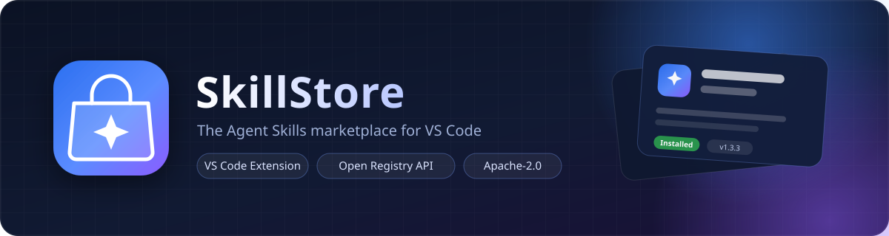
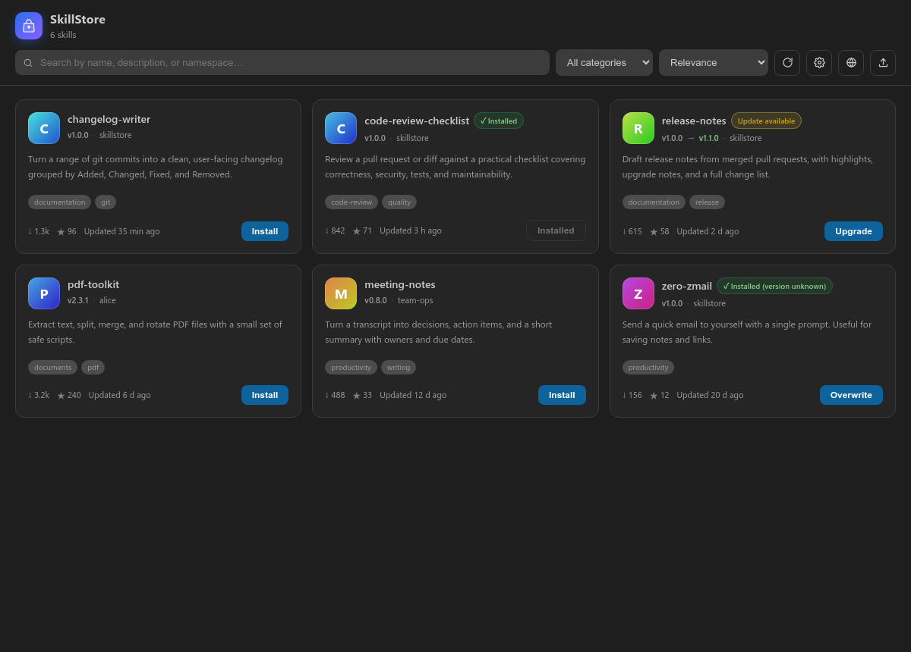
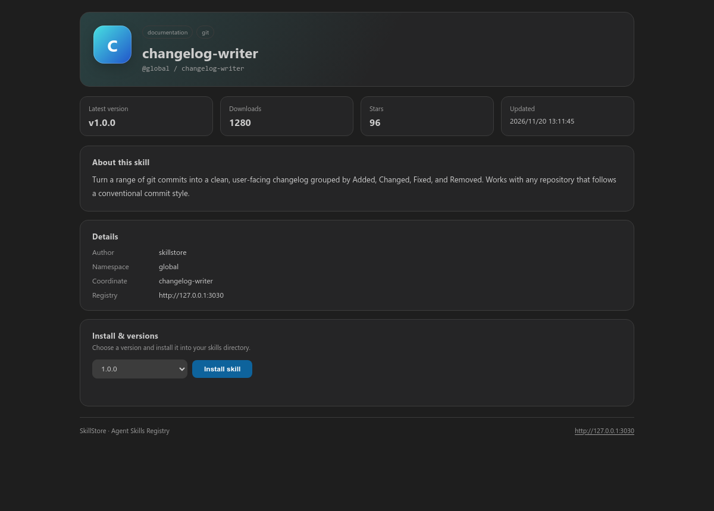
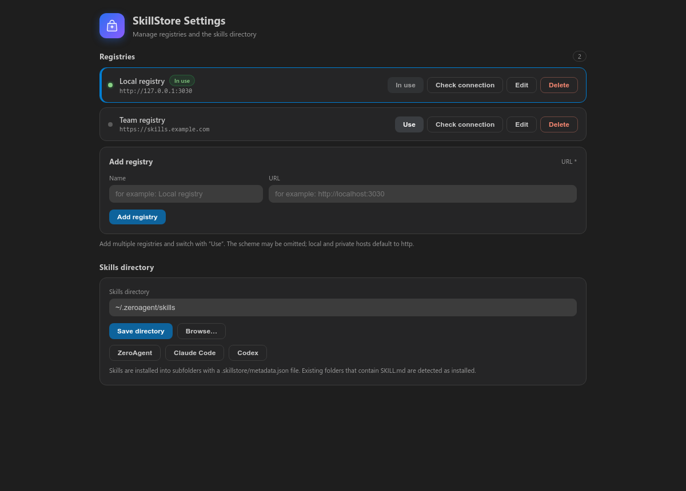
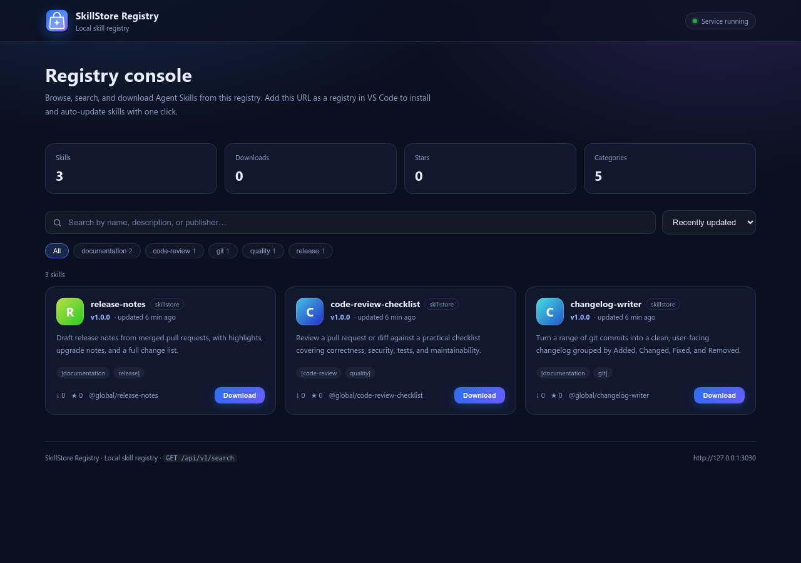
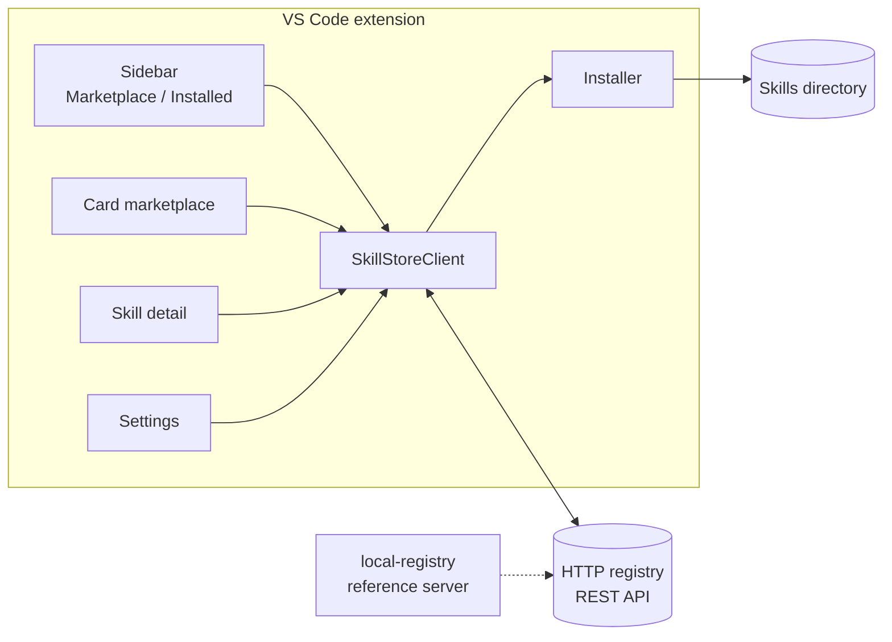

<div align="center">



<br/>

**The missing marketplace for Agent Skills — inside VS Code.**

Discover, install, update, and publish `SKILL.md` skills from any registry without leaving your editor.

<br/>

[](https://code.visualstudio.com/)
[](https://www.typescriptlang.org/)
[](https://nodejs.org/)
[](#development)
[](#-publish-a-skill)
[](LICENSE)
[](#-contributing)

[English](README.md) · [简体中文](README.zh-CN.md)

</div>

---

## Why SkillStore?

Agent Skills are just folders with a `SKILL.md` file — but installing, versioning, updating, and sharing them is still a manual chore. SkillStore turns that into a first-class editor experience:

- **One marketplace for every registry.** Local folders, a team server, or a public index — switch without reconfiguring your workflow.
- **Installs that don't surprise you.** Version selection, atomic swaps, explicit overwrite confirmation, and opt-in auto-update.
- **Publish without leaving the editor.** Package a skill, pick a version strategy, and upload it to a registry. Secrets and `node_modules` are excluded automatically.
- **Bring your own agent.** Point the skills directory at `~/.claude/skills`, `~/.zeroagent/skills`, `~/.codex/skills`, or any folder your agent reads.

> SkillStore manages skill files. Your agent decides how to load and run them.

## Screenshots

> The extension is bilingual: it follows your VS Code display language and falls back to English.

<table>
  <tr>
    <td width="50%" align="center" valign="top">
      <br/>
      <sub><b>Card marketplace</b> · search, categories, sorting, install state, and upgrades</sub>
    </td>
    <td width="50%" align="center" valign="top">
      <br/>
      <sub><b>Skill detail</b> · stats, version picker, install, and auto-update</sub>
    </td>
  </tr>
  <tr>
    <td width="50%" align="center" valign="top">
      <br/>
      <sub><b>Settings</b> · multi-registry management, presets, and connectivity checks</sub>
    </td>
    <td width="50%" align="center" valign="top">
      <br/>
      <sub><b>Reference registry</b> · a zero-dependency server with a browser UI</sub>
    </td>
  </tr>
</table>

## Features

<table>
  <tr>
    <td width="50%" valign="top">
      <h3>🛍️ Card marketplace</h3>
      <p>Search, filter by category, sort by downloads/stars/recency, and see installed or upgradable state at a glance.</p>
    </td>
    <td width="50%" valign="top">
      <h3>🌲 Sidebar tree</h3>
      <p>Keep the marketplace next to your files. Categories, search, install state, and inline actions without opening a tab.</p>
    </td>
  </tr>
  <tr>
    <td width="50%" valign="top">
      <h3>📦 Versioned installs</h3>
      <p>Pick a version, install, upgrade, or downgrade. Installs are staged and swapped atomically; existing folders are never overwritten silently.</p>
    </td>
    <td width="50%" valign="top">
      <h3>🔄 Opt-in auto-update</h3>
      <p>Check for updates on startup and at a configurable interval. Enable or disable auto-update per skill.</p>
    </td>
  </tr>
  <tr>
    <td width="50%" valign="top">
      <h3>🗂️ Multi-registry</h3>
      <p>Add, edit, switch, and remove registries. A status-bar item shows the active registry; a settings panel shows connectivity.</p>
    </td>
    <td width="50%" valign="top">
      <h3>📤 Publish from VS Code</h3>
      <p>Package a local skill folder and upload it with auto-increment, manual, or force-overwrite version strategies.</p>
    </td>
  </tr>
  <tr>
    <td width="50%" valign="top">
      <h3>🛡️ Secure by design</h3>
      <p>Zip-slip and path-traversal checks, extraction size limits, metadata-based uninstall, and sensitive-file exclusion when publishing.</p>
    </td>
    <td width="50%" valign="top">
      <h3>🌍 Bilingual & theme-native</h3>
      <p>English and Chinese UI, native VS Code theme variables, light/dark/high-contrast support, and no telemetry.</p>
    </td>
  </tr>
</table>

## Quick start

### Install from a VSIX

```bash
npm install
npm run package
code --install-extension skillstore-0.1.1.vsix
```

### Try the one-command demo

The repository ships with a local registry and three example skills:

```bash
npm install
npm run demo
```

Then open VS Code in this folder and run **SkillStore: Card View** from the Command Palette. The demo registry listens on `http://127.0.0.1:3030`, which is the default registry address.

### Run from source

```bash
npm install
npm run watch
# press F5 in VS Code to launch the Extension Development Host
```

## Works with your agent

A skill is a directory with a `SKILL.md` file. Point `skillstore.installDir` at the directory your agent reads:

| Agent | Common skills directory |
|-------|-------------------------|
| ZeroAgent | `~/.zeroagent/skills` |
| Claude Code | `~/.claude/skills` |
| Codex | `~/.codex/skills` |
| Custom | any folder |

The settings panel includes presets for these locations, plus a folder picker. Manually placed folders that contain `SKILL.md` are detected as installed and can be adopted with an explicit confirmation.

## Architecture



The extension talks to any registry that implements the contract in [docs/REGISTRY_API.md](docs/REGISTRY_API.md). The bundled `local-registry/` server is a zero-dependency reference implementation with a browser UI.

## Publish a skill

```text
my-skill/
├── SKILL.md
└── references/
    └── checklist.md
```

```yaml
---
name: my-skill
description: What this skill does and when an agent should use it.
version: 1.0.0
categories: [productivity]
author: your-handle
---

# My Skill

Instructions the agent should follow...
```

Run **SkillStore: Publish Skill to Registry**, choose the folder, and pick a version strategy. Or use the CLI:

```bash
node local-registry/publish.js path/to/my-skill --namespace global --version 1.0.0
```

Sensitive files (`.env`, private keys, credentials) and `node_modules` are excluded from the package.

## Configuration

| Setting | Default | Description |
|---------|---------|-------------|
| `skillstore.registries` | `[{"id":"local","name":"Local registry","url":"http://127.0.0.1:3030"}]` | Registries to browse |
| `skillstore.activeRegistry` | `local` | Active registry id |
| `skillstore.registry` | empty | Legacy single-registry URL |
| `skillstore.installDir` | `~/.zeroagent/skills` | Directory where skills are installed |
| `skillstore.openMarketOnStartup` | `false` | Open the card marketplace on startup |
| `skillstore.autoUpdateIntervalMinutes` | `20` | Update-check interval in minutes |
| `skillstore.showStatusBar` | `true` | Show the active registry in the status bar |

## Commands

| Command | Description |
|---------|-------------|
| `SkillStore: Card View` | Open the card marketplace |
| `SkillStore: Search Skills` | Search the active registry |
| `SkillStore: Open Settings` | Manage registries and the skills directory |
| `SkillStore: Install Skill` | Install a skill |
| `SkillStore: Upgrade Skill` | Upgrade an installed skill |
| `SkillStore: Uninstall Skill` | Uninstall a skill |
| `SkillStore: Publish Skill to Registry` | Package and upload a skill |
| `SkillStore: Check for Skill Updates` | Scan installed skills for updates |
| `SkillStore: Open Skill Folder` | Reveal an installed skill in the file manager |
| `SkillStore: Open SKILL.md` | Open the installed skill manifest |
| `SkillStore: Copy Skill Coordinate` | Copy `namespace/slug` to the clipboard |
| `SkillStore: Switch Registry` | Change the active registry |
| `SkillStore: Add Registry` / `Remove Registry` | Manage registries |
| `SkillStore: Open Registry in Browser` | Open the active registry Web UI |

## Local registry server

The `local-registry/` folder is a standalone, zero-dependency Node.js server. It is **not** bundled into the VSIX.

```bash
npm run registry
# or
node local-registry/server.js --port 3030 --dir .skillstore-registry
```

Open <http://localhost:3030> for the browser UI. The server also supports an optional bearer token:

```bash
node local-registry/server.js --port 3030 --token "$SKILLSTORE_TOKEN"
```

See [docs/REGISTRY_API.md](docs/REGISTRY_API.md) for the full API.

## Development

```bash
npm install          # install dependencies
npm run watch        # compile in watch mode
npm run lint         # type-check
npm test             # unit + integration tests
npm run verify       # lint + tests
npm run package      # build a VSIX
```

CI runs `npm run verify` on every push and pull request. See [.github/workflows/ci.yml](.github/workflows/ci.yml).

## Project structure

```text
skillstore/
├── package.json              # extension manifest
├── package.nls.json          # English manifest strings
├── package.nls.zh-cn.json    # Chinese manifest strings
├── src/
│   ├── extension.ts          # activation, commands, views
│   ├── config.ts             # registry and settings access
│   ├── i18n.ts               # runtime English/Chinese messages
│   ├── util.ts               # semver, URL normalization, paths
│   ├── httpClient.ts         # HTTP/HTTPS client with redirects
│   ├── skillstoreClient.ts   # registry API client
│   ├── installer.ts          # safe install/uninstall/scan
│   ├── publish.ts            # package and upload skills
│   ├── skillTree.ts          # sidebar tree providers
│   ├── marketPanel.ts        # card marketplace webview
│   ├── webview.ts            # skill detail webview
│   └── settingsPanel.ts      # settings webview
├── test/
│   ├── unit/                 # mocha unit tests
│   ├── integration/          # registry e2e tests
│   └── helpers/              # VS Code API mock
├── local-registry/           # reference registry server
├── examples/skills/          # example skills
├── scripts/
│   ├── demo.js               # one-command demo
│   └── preview.js            # render webviews for screenshots
└── media/
    ├── banner.svg            # repository banner
    └── screenshots/en/       # README screenshots
```

## Contributing

Contributions are welcome. Start with [CONTRIBUTING.md](CONTRIBUTING.md), open an issue, or pick a `good first issue`.

- Read the [Code of Conduct](CODE_OF_CONDUCT.md).
- Report security issues privately via [SECURITY.md](SECURITY.md).
- Run `npm run verify` before opening a pull request.

If SkillStore saves you time, a ⭐ helps other developers find it.

## License

[Apache-2.0](LICENSE) © SkillStore Contributors
