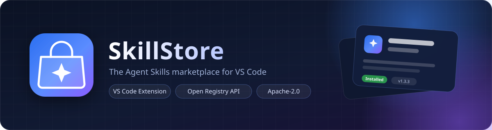
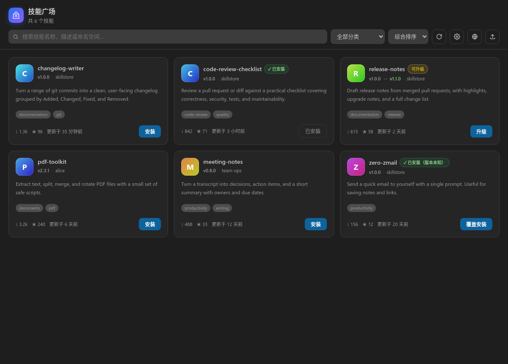
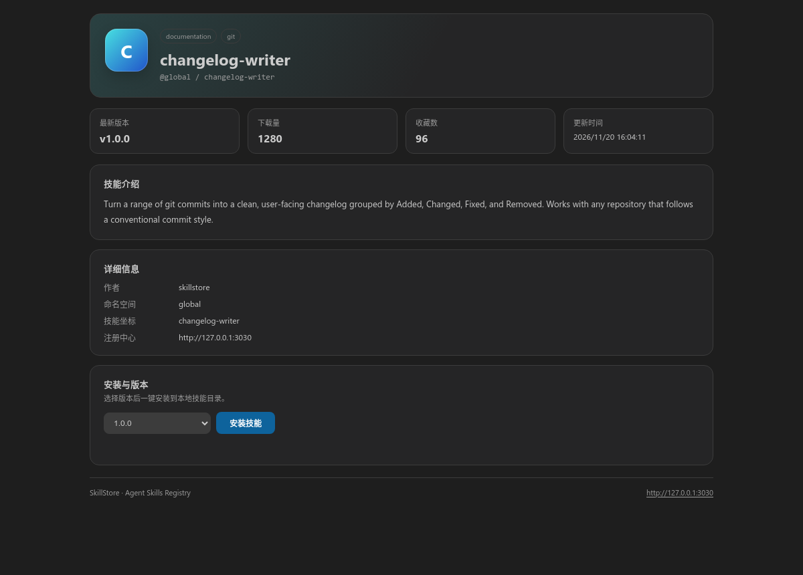
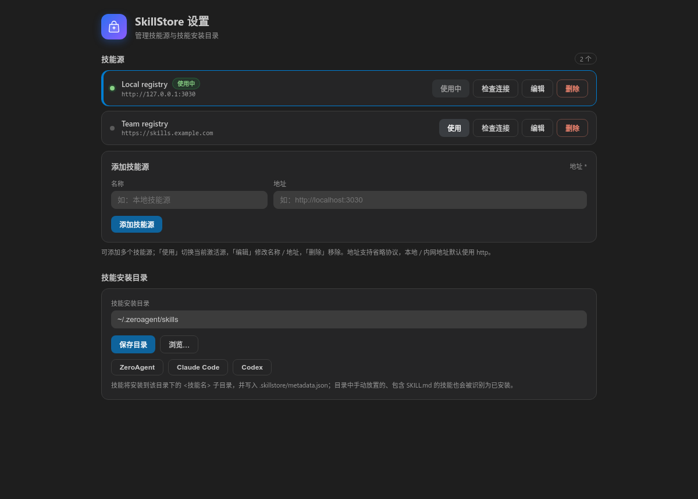
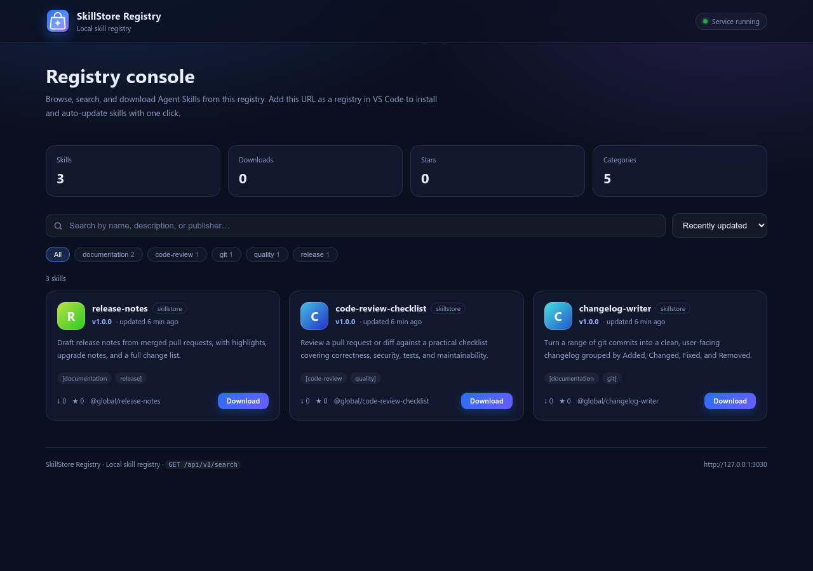
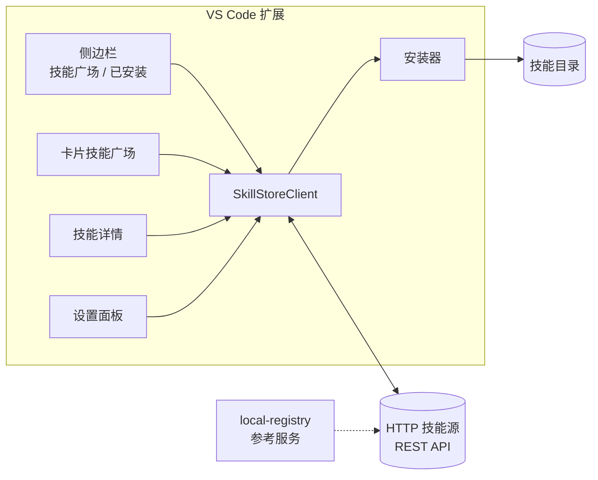

<div align="center">



<br/>

**VS Code 中的 Agent Skills 市场**

在编辑器内浏览、搜索、安装、更新和发布 `SKILL.md` 技能，无需离开 IDE 或使用命令行。

<br/>

[](https://code.visualstudio.com/)
[](https://www.typescriptlang.org/)
[](https://nodejs.org/)
[](#开发与测试)
[](#-发布技能)
[](LICENSE)
[](#-贡献)

[English](README.md) · [简体中文](README.zh-CN.md)

</div>

---

## 为什么选择 SkillStore？

Agent Skill 本质上只是一个包含 `SKILL.md` 的目录，但安装、版本管理、更新和分享仍然很繁琐。SkillStore 把这些操作变成编辑器内的一等体验：

- **一个市场，管理所有技能源。** 本地目录、团队服务或公共索引，切换技能源无需改变工作流。
- **安装过程可预期。** 版本选择、原子替换、覆盖前二次确认、按需开启自动更新。
- **无需离开编辑器即可发布。** 打包技能、选择版本策略并上传；自动排除密钥和 `node_modules`。
- **兼容你的智能体。** 将技能目录指向 `~/.claude/skills`、`~/.zeroagent/skills`、`~/.codex/skills` 或任意目录。

> SkillStore 负责管理技能文件，具体如何加载和运行由你的智能体决定。

## 界面预览

> 截图展示的是中文界面（参考技能源 Web UI 为英文）。扩展会根据 VS Code 显示语言自动选择中文或英文。

<table>
  <tr>
    <td width="50%" align="center" valign="top">
      <br/>
      <sub><b>卡片式技能广场</b> · 搜索、分类、排序、安装状态与升级</sub>
    </td>
    <td width="50%" align="center" valign="top">
      <br/>
      <sub><b>技能详情</b> · 统计、版本选择、安装与自动更新</sub>
    </td>
  </tr>
  <tr>
    <td width="50%" align="center" valign="top">
      <br/>
      <sub><b>设置面板</b> · 多技能源管理、安装目录预设与连通性检查</sub>
    </td>
    <td width="50%" align="center" valign="top">
      <br/>
      <sub><b>参考技能源</b> · 零依赖服务与浏览器界面</sub>
    </td>
  </tr>
</table>

## 功能特性

<table>
  <tr>
    <td width="50%" valign="top">
      <h3>🛍️ 卡片式技能广场</h3>
      <p>关键词搜索、分类筛选、按下载/收藏/更新时间排序，一眼看出已安装或可升级状态。</p>
    </td>
    <td width="50%" valign="top">
      <h3>🌲 侧边栏树视图</h3>
      <p>技能广场常驻侧边栏，按分类分组，支持搜索、安装状态与行内操作。</p>
    </td>
  </tr>
  <tr>
    <td width="50%" valign="top">
      <h3>📦 版本化安装</h3>
      <p>选择版本安装、升级或降级；安装采用暂存与原子替换，已有目录不会被静默覆盖。</p>
    </td>
    <td width="50%" valign="top">
      <h3>🔄 按需自动更新</h3>
      <p>启动时检查更新，之后按配置间隔轮询；可逐个技能开启或关闭自动更新。</p>
    </td>
  </tr>
  <tr>
    <td width="50%" valign="top">
      <h3>🗂️ 多技能源</h3>
      <p>添加、编辑、切换和删除技能源；状态栏显示当前源，设置面板可检查连通性。</p>
    </td>
    <td width="50%" valign="top">
      <h3>📤 编辑器内发布</h3>
      <p>选择本地技能目录即可打包上传，支持自动递增、手动指定与强制覆盖版本策略。</p>
    </td>
  </tr>
  <tr>
    <td width="50%" valign="top">
      <h3>🛡️ 安全设计</h3>
      <p>Zip-slip 与路径穿越校验、解压大小限制、基于元数据的卸载校验，发布时排除敏感文件。</p>
    </td>
    <td width="50%" valign="top">
      <h3>🌍 双语与原生主题</h3>
      <p>支持中英文界面，使用 VS Code 主题变量，适配浅色/深色/高对比度，无遥测。</p>
    </td>
  </tr>
</table>

## 快速开始

### 安装 VSIX

```bash
npm install
npm run package
code --install-extension skillstore-0.1.1.vsix
```

### 一键体验 Demo

仓库内置本地技能源与三个示例技能：

```bash
npm install
npm run demo
```

然后在 VS Code 中打开本目录，运行命令 **SkillStore: 卡片视图**。Demo 技能源监听 `http://127.0.0.1:3030`，这也是插件默认的技能源地址。

### 从源码运行

```bash
npm install
npm run watch
# 在 VS Code 中按 F5 启动扩展开发宿主
```

## 兼容你的智能体

技能就是一个包含 `SKILL.md` 的目录。将 `skillstore.installDir` 指向你的智能体读取的目录：

| 智能体 | 常见技能目录 |
|--------|--------------|
| ZeroAgent | `~/.zeroagent/skills` |
| Claude Code | `~/.claude/skills` |
| Codex | `~/.codex/skills` |
| 自定义 | 任意目录 |

设置面板提供上述目录的预设与文件夹选择器。手动放置且包含 `SKILL.md` 的目录会被识别为已安装，并可在二次确认后接管。

## 架构



插件可与任何实现 [docs/REGISTRY_API.md](docs/REGISTRY_API.md) 契约的技能源通信。仓库中的 `local-registry/` 是零依赖参考实现，自带浏览器界面。

## 发布技能

```text
my-skill/
├── SKILL.md
└── references/
    └── checklist.md
```

```yaml
---
name: my-skill
description: 这个技能做什么，以及智能体何时应该使用它。
version: 1.0.0
categories: [productivity]
author: your-handle
---

# My Skill

智能体应遵循的指令……
```

在命令面板运行 **SkillStore: 发布技能到技能源**，选择目录与版本策略。也可以使用 CLI：

```bash
node local-registry/publish.js path/to/my-skill --namespace global --version 1.0.0
```

敏感文件（`.env`、私钥、凭证）与 `node_modules` 会自动排除。

## 配置

| 设置项 | 默认值 | 说明 |
|--------|--------|------|
| `skillstore.registries` | `[{"id":"local","name":"Local registry","url":"http://127.0.0.1:3030"}]` | 技能源列表 |
| `skillstore.activeRegistry` | `local` | 当前激活的技能源 ID |
| `skillstore.registry` | 空 | 旧版单技能源地址 |
| `skillstore.installDir` | `~/.zeroagent/skills` | 技能安装目录 |
| `skillstore.openMarketOnStartup` | `false` | 启动时自动打开卡片技能广场 |
| `skillstore.autoUpdateIntervalMinutes` | `20` | 检查更新间隔（分钟） |
| `skillstore.showStatusBar` | `true` | 在状态栏显示当前技能源 |

## 命令

| 命令 | 说明 |
|------|------|
| `SkillStore: 卡片视图` | 打开卡片式技能广场 |
| `SkillStore: 搜索技能` | 搜索当前技能源 |
| `SkillStore: 打开设置` | 管理技能源与技能目录 |
| `SkillStore: 安装技能` | 安装技能 |
| `SkillStore: 升级技能` | 升级已安装技能 |
| `SkillStore: 卸载技能` | 卸载技能 |
| `SkillStore: 发布技能到技能源` | 打包并上传技能 |
| `SkillStore: 检查技能更新` | 扫描已安装技能的更新 |
| `SkillStore: 打开技能目录` | 在文件管理器中显示技能 |
| `SkillStore: 打开 SKILL.md` | 打开技能清单 |
| `SkillStore: 复制技能坐标` | 复制 `namespace/slug` 到剪贴板 |
| `SkillStore: 切换技能源` | 切换当前技能源 |
| `SkillStore: 添加技能源` / `删除技能源` | 管理技能源 |
| `SkillStore: 在浏览器打开技能源` | 打开技能源 Web UI |

## 本地技能源

`local-registry/` 是独立的零依赖 Node.js 服务，**不会打包进 VSIX**。

```bash
npm run registry
# 或
node local-registry/server.js --port 3030 --dir .skillstore-registry
```

访问 <http://localhost:3030> 打开浏览器界面。服务还支持可选的 Bearer Token：

```bash
node local-registry/server.js --port 3030 --token "$SKILLSTORE_TOKEN"
```

完整 API 见 [docs/REGISTRY_API.md](docs/REGISTRY_API.md)。

## 开发与测试

```bash
npm install          # 安装依赖
npm run watch        # 监听编译
npm run lint         # 类型检查
npm test             # 单元 + 集成测试
npm run verify       # 类型检查 + 测试
npm run package      # 打包 VSIX
```

CI 在每次 push 与 PR 时运行 `npm run verify`，见 [.github/workflows/ci.yml](.github/workflows/ci.yml)。

## 项目结构

```text
skillstore/
├── package.json              # 扩展清单
├── package.nls.json          # 英文清单文案
├── package.nls.zh-cn.json    # 中文清单文案
├── src/
│   ├── extension.ts          # 激活、命令与视图
│   ├── config.ts             # 技能源与设置访问
│   ├── i18n.ts               # 运行时中英文案
│   ├── util.ts               # semver、URL 归一化、路径
│   ├── httpClient.ts         # HTTP/HTTPS 客户端
│   ├── skillstoreClient.ts   # 技能源 API 客户端
│   ├── installer.ts          # 安全安装/卸载/扫描
│   ├── publish.ts            # 打包与上传
│   ├── skillTree.ts          # 侧边栏树提供器
│   ├── marketPanel.ts        # 卡片技能广场 Webview
│   ├── webview.ts            # 技能详情 Webview
│   └── settingsPanel.ts      # 设置 Webview
├── test/
│   ├── unit/                 # 单元测试
│   ├── integration/          # 技能源端到端测试
│   └── helpers/              # VS Code API mock
├── local-registry/           # 参考技能源服务
├── examples/skills/          # 示例技能
├── scripts/
│   ├── demo.js               # 一键 Demo
│   └── preview.js            # 渲染 webview 截图
└── media/
    ├── banner.svg            # 仓库横幅
    └── screenshots/en/       # 英文界面截图
```

## 贡献

欢迎提交 Issue 与 PR。请先阅读 [CONTRIBUTING.md](CONTRIBUTING.md)，或从 `good first issue` 开始。

- 遵守 [行为准则](CODE_OF_CONDUCT.md)。
- 安全问题请按 [SECURITY.md](SECURITY.md) 私下报告。
- 提交 PR 前运行 `npm run verify`。

如果 SkillStore 节省了你的时间，欢迎点一个 ⭐，让更多开发者发现它。

## 许可证

[Apache-2.0](LICENSE) © SkillStore Contributors
