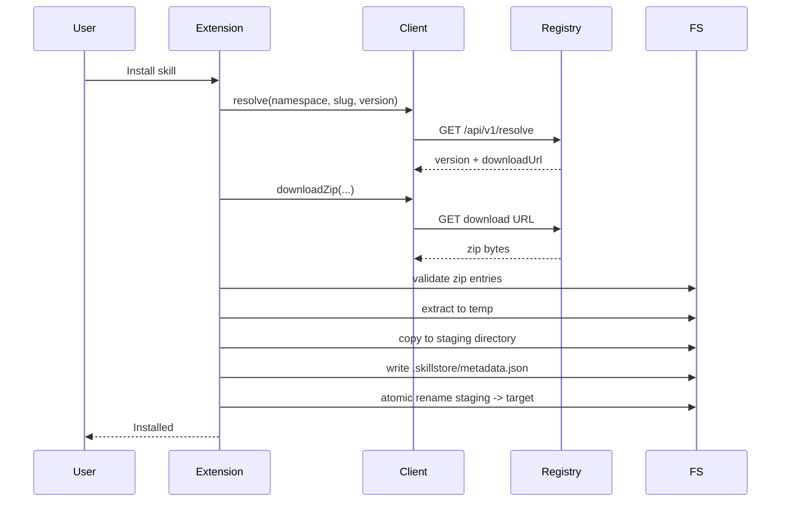

# Architecture

SkillStore has two independent parts:

1. **The VS Code extension** (`src/`) — UI, registry client, installer, publisher.
2. **The reference registry** (`local-registry/`) — a zero-dependency Node.js HTTP server.

The extension does not embed the registry. It only needs a URL that implements the
contract in [REGISTRY_API.md](REGISTRY_API.md).

## Module map

| Module | Responsibility |
|--------|----------------|
| `extension.ts` | Activation, commands, tree views, auto-update timer, status bar |
| `config.ts` | Registry list, active registry, install directory, runtime settings |
| `i18n.ts` | Runtime English/Chinese messages and language detection |
| `util.ts` | Semver comparison, registry URL normalization, `~` expansion |
| `httpClient.ts` | HTTP/HTTPS requests, redirects, gzip, timeouts, keep-alive |
| `skillstoreClient.ts` | Typed registry API client |
| `installer.ts` | Zip validation, staging, atomic swap, uninstall, local scan |
| `publish.ts` | Skill packaging, `.skillignore`, multipart upload |
| `skillTree.ts` | Sidebar tree providers for marketplace and installed skills |
| `marketPanel.ts` | Card marketplace webview |
| `webview.ts` | Skill detail webview |
| `settingsPanel.ts` | Settings webview |

## Install flow

### Safety properties

- **Zip-slip protection** — entry names are rejected if absolute, containing `..`,
  or containing NUL bytes.
- **Extraction limits** — maximum entry count and total uncompressed size.
- **Staging + rename** — a failed install never leaves a half-written target.
- **Metadata-gated uninstall** — only directories with `.skillstore/metadata.json`
  can be removed by the extension.
- **Manual skill adoption** — a folder with `SKILL.md` but no metadata is treated
  as manually managed; overwriting requires explicit confirmation.
- **Publish exclusions** — `.env`, private keys, credentials, `.git`,
  `node_modules`, and `.skillstore` are excluded.

## Registry abstraction

`SkillStoreClient` only assumes four capabilities:

- `search`
- `resolve`
- `download`
- `publish`

The bundled registry also exposes categories, details, versions, and a browser UI.
The client degrades gracefully when optional endpoints are missing.

## Extension lifecycle

1. Register tree views, commands, and status bar.
2. Scan the install directory.
3. Merge registry-known manual skills into the installed view.
4. Schedule an update check after 3 seconds and then at the configured interval.
5. React to configuration changes for install directory, registries, status bar,
   and update interval.

The card marketplace is **not** opened automatically unless
`skillstore.openMarketOnStartup` is enabled.

## Testing strategy

- **Unit tests** cover pure logic, installer safety, client fallbacks, tree
  rendering, i18n, and configuration.
- **Integration tests** start a real `local-registry` server, publish skills,
  search, resolve, download, and verify package contents.
- VS Code APIs are mocked in `test/helpers/vscode-mock.js` so the extension code
  runs in plain Node.js.
